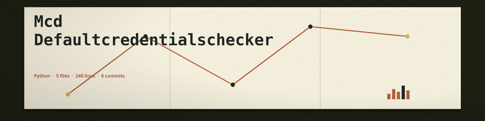

# mcd-DefaultCredentialsChecker
Checks common configuration files (e.g., `.env`, `.config`) for the presence of default credentials (usernames and passwords) using a built-in dictionary of known default values and regular expressions. Uses `re` and `os` modules. - Focused on Detects misconfigurations in cloud environments (AWS, Azure, GCP) and infrastructure-as-code (IaC) templates (e.g., Terraform, CloudFormation).  Parses configuration files and cloud API responses, applying predefined or custom rules to identify deviations from security best practices.  Focuses on common issues such as overly permissive IAM policies, exposed storage buckets, and insecure network configurations.

The run exits 1 when the scan path is invalid, or when a credentials file named with `-c` or a rules file named with `-r` cannot be loaded, instead of falling back to the built in dictionary or running with no rules.

## Install
`git clone https://github.com/ShadowGuardAI/mcd-defaultcredentialschecker`

## Usage
`./mcd-defaultcredentialschecker [params]`

## Parameters
- `-h`: Show help message and exit
- `-c`: Path to a YAML file containing custom default credentials.
- `-r`: Path to a YAML file containing custom misconfiguration rules.
- `-v`: Enable verbose output.

## License
Copyright (c) ShadowGuardAI
